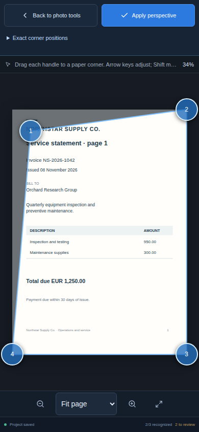

# Phone photo preparation

On phone layouts, **Prepare photo** has three visible steps: **Check**, **Corners**, and **Lighting**. Only the selected step's controls are shown. Desktop layouts retain all preparation panels.

Choosing **Corners** fits the page and opens a focused editor. The project header, command bar, page navigation, image tools, and preparation panel give their space to the image. **Back to photo tools**, **Apply perspective**, zoom, and Fit page remain available. Each corner handle and the focused editor's action controls have a minimum 44 CSS pixel touch target. Zoom can be changed while placing corners; Fit page brings all four handles back into view.

**Exact corner positions** opens a compact numeric drawer in the focused editor. Each coordinate is bounded by the image dimensions and uses the same quadrilateral validation as touch editing. Invalid selections disable Apply. The drawer starts collapsed; its contents scroll independently while Back and Apply stay in the top row. Numeric inputs are at least 44 CSS pixels high and use 16 pixel text on phones.

Dragging a corner changes only the pending selection. Back or Escape restores the tool chrome without changing image pixels. Apply sends the selected quadrilateral to the existing perspective transform. The preserved original remains available, and Undo restores the previous image and review evidence.

## Verification scope

The browser harness exercises the production Svelte components at 390×844. Its phone corner case measures a fitted portrait page of at least 300×420 CSS pixels, a canvas at least 540 CSS pixels high, and four complete touch targets inside both the canvas and the screen. It sends native browser touch input through Chromium's input protocol and checks that the trusted touch pointer updates the expected image coordinates. It also checks Back, Escape, Apply, preservation of the original, Undo, and the absence of recognition calls.

The case also rejects a degenerate numeric selection, recovers after valid coordinates, and verifies touch sizing for the numeric inputs and preparation close button. The browser report retains measured geometry and touch evidence in `phoneCornerEvidence`, and captures `ocr-phone-corner-focus.png`. This case uses a synthetic document and transform client. It qualifies the user interface and coordinate handling; native perspective quality and physical phone camera/provider behavior require their separate native and device checks. A passing hosted run and its source revision must be recorded before claiming the new browser case has passed.

### Retained phone-case result

The phone corner case passed on source `fbc03f742ff92fea6f88b531f0e2d9794cdef674`, hosted run `42631253524`. At 390×844, it measured a 390×620 canvas and a 342×478.8 fitted page. All four 44×44 handles were inside the canvas and screen. A trusted touch pointer moved 36×42 screen pixels and updated the selected image coordinate to 105×123, with no transform before Apply. Numeric invalid/recovery, Back, Escape, Apply, and restoration through Undo also passed.

The complete run had **31 passed and 2 failed browser cases**, zero browser errors, 233 passing frontend tests, and zero Svelte errors. Its historical failures are preserved: the archival negative assertion followed the enclosing label to the enabled select, and the desktop corner assertion matched both the desktop disclosure and the hidden phone drawer. Follow-ups `76bf5d8d` and `9e0f0fe1` correct those assertions. This is a passing phone case, not a claim that the historical full browser run passed.

The [qualification receipt](../tests/results/ocr-mobile-ui/hosted-fbc03f74/qualification.json), unchanged [browser report](../tests/results/ocr-mobile-ui/hosted-fbc03f74/report.json), selected screenshots, and failure screenshots are retained with SHA-256 identities. The archive download matched `8e4a723a15fa4f7f2744ef8a3a6797a4b042084164dda6aaa443b903a50a5709`.

